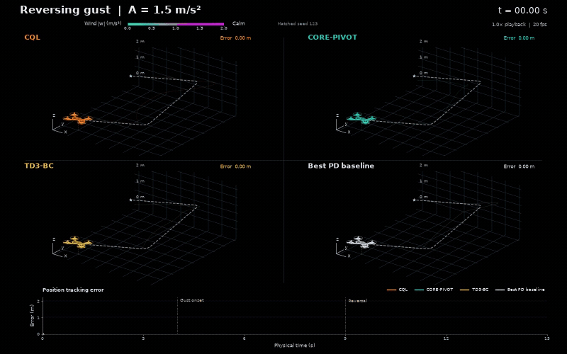

# CORE-PIVOT

Offline control under changing disturbances: conservative behavioural value
learning, policy extraction and deployment-time action improvement.

**Preprint forthcoming.** The accompanying manuscript is in preparation, with
preprint release planned soon. A link and updated citation will be added here
when available.



The drone illustrates a translational point-mass benchmark, not full quadrotor
flight dynamics. The animation uses saved rollouts; it is not a new evaluation.

## Start here

**[Reviewer walkthrough: easy to verify, possible to reproduce](docs/GUIDE.md)**

1. **View:** inspect the animation and regenerate the current paper figures and
   performance tables from bundled results.
2. **Verify:** evaluate released controllers on the specified winds, without training.
3. **Reproduce:** optionally generate the dataset, train and evaluate all five seeds.

The walkthrough gives commands, expected outputs, a figure/table map and storage
requirements. You do not need VS Code, a notebook, or the full training dataset
to verify a saved controller.

## Quick Windows check

Install [Git](https://git-scm.com/downloads), then clone once:

```powershell
git clone https://github.com/AISL-at-Imperial-College-London/CORE-PIVOT-release.git
cd CORE-PIVOT-release
```

If already cloned, use `git pull --ff-only` inside the existing folder instead.
Run one line at a time:

```powershell
.\setup.cmd
.\review.cmd python scripts/download_checkpoints.py
.\review.cmd python scripts/download_checkpoints.py --verify-only
.\review.cmd evaluate iql --seed 123 --winds 1 --output runs/reviewer/iql_smoke.json
```

Setup finds or installs uv and uses the locked CPU environment. No Python or uv
on PATH, PowerShell activation, or training is required. Expected episode costs
are approximately **69.9878** (ordinary) and **237.872** (stronger wind). This is
a two-episode software check, not a complete benchmark. Existing outputs are
protected: use a new `--output` filename if repeating a run.

For Linux/macOS, manual uv installation or CUDA, see [setup](docs/SETUP.md).
The repository and selected checkpoints are public; no GitHub sign-in is required.

## Make the figures and tables

```powershell
.\review.cmd python scripts/reproduce_paper.py
explorer .\figures\reproduced
```

This command reproduces the current manuscript's figure set, including the
separate dataset plots, stacked test violins, tuning sweeps and trajectory grids.
It reads archived results; it does not train or evaluate controllers. Numerical
plots are SVG/PDF/PNG and performance tables are CSV. Schematic PDFs and their
standalone TikZ sources are bundled; rebuilding them requires a TeX installation.
Use `--list` to see the figure map, or `--figure 10` for one figure. See the
[walkthrough](docs/GUIDE.md#figures-and-tables) for details.

## Storage

- **Figures/tables:** about 95 MiB of numerical archives, mostly saved trajectory
  coordinates, plus schematic/demo assets. No replay or model checkpoint is required.
- **Released controllers:** about 267 MiB to download, 311 MiB extracted.
- **Full training only:** 5.52 GB of replay arrays, plus checkpoints and working
  space. A roughly 1 MB smoke replay is available for checking data generation.
- The Python environment, uv cache and generated outputs require additional space.

## Code and documentation

| Location | Purpose |
|---|---|
| `run.py`, `setup.cmd`, `review.cmd` | Reviewer entry points |
| `algorithms/`, `training/`, `extraction/` | Learning and policy extraction |
| `environments/`, `datasets/`, `evaluation/` | Task, data generation and evaluation |
| `configs/` | Selected settings, seeds and tuning grids |
| `scripts/` | Training, evaluation, plotting and table export |
| `results/paper_data/`, `assets/` | Archived results and visual assets |
| [Detailed reproduction](docs/REPRODUCING.md) | Full training and ablation recipes |
| [Verification](docs/VERIFICATION.md) | Tested scope and numerical limitations |

Main methods: BC, EasyBCQ, HOFLON-EasyBCQ, CORE-PIVOT, TD3-BC, IQL, CQL and the
best PD baseline in training. EasyBCQ and HOFLON-EasyBCQ share behavioural critic
fits; the hybrid is not the original autoencoder-regularised HOFLON implementation.

## Citation and release status

The manuscript authors are **Christos Evripidou, Benoît Chachuat and Mehmet
Mercangöz**; see [CITATION.cff](CITATION.cff). Software authorship and maintenance
remain attributed to Christos Evripidou. Third-party credits and licenses are
retained in [NOTICE.md](NOTICE.md).

This is a **public reproduction package** maintained under AISL. The manuscript
has not yet been published. See [verification](docs/VERIFICATION.md) for the scope
of reproduction checks.

## License

Original code and accompanying repository materials are available under the
[MIT License](LICENSE), copyright (c) 2026 Autonomous Industrial Systems Laboratory,
unless identified otherwise. CORL-derived code retains its Apache-2.0 license;
see [NOTICE.md](NOTICE.md) for scope and attribution. This does not license the
accompanying manuscript.
